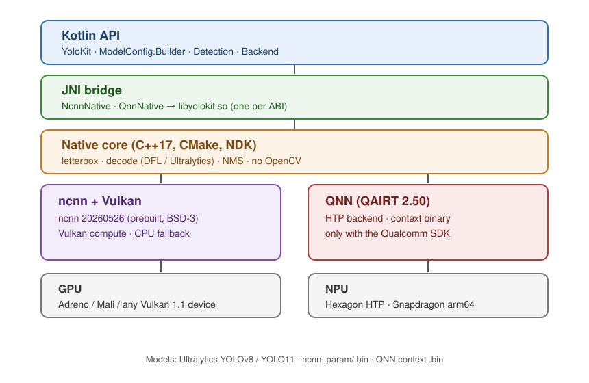

<h1 align="center">YoloKit</h1>

<p align="center">Распознавание объектов с помощью YOLO на Android.</p>

<div align="center">
  
  
  
  
  
  
  
  
  
</div>

<p align="center"><a href="README.md">English</a> · <b>Русский</b></p>

YoloKit запускает модели YOLO на Android. Библиотека принимает Bitmap
и возвращает рамки объектов, названия классов и оценки уверенности. Kotlin API
одинаковый для ncnn с Vulkan и Qualcomm QNN на NPU Hexagon.

В [YoloKitMobile](https://github.com/gd182/YoloKitMobile) есть пример с камерой:
передача кадров в детектор, отрисовка результатов, смена моделей и остановка
распознавания. Релизы библиотеки будут содержать AAR без весов моделей.
Опубликованные версии доступны в [Releases](https://github.com/gd182/YoloKit/releases).

## Требования

Библиотека работает на Android 7.0 и новее (`minSdk 24`). Сборки ncnn
включены для `arm64-v8a`, `armeabi-v7a` и `x86_64`. Если Vulkan доступен,
используется GPU; `.useGpu(false)` выбирает CPU. Для QNN нужны arm64-устройство
Qualcomm и библиотека, собранная с QAIRT SDK.

Для сборки из исходников нужны Android Studio с поддержкой AGP 9.4.0,
JDK 17 или новее, Android SDK 37, Android NDK и CMake 3.22.1.
Используйте Gradle wrapper из репозитория (9.6.0). Нативный код написан на
C++17; в проекте используются ncnn 20260526 и QNN runtime 2.50.0.
Версии указаны в [каталоге зависимостей](gradle/libs.versions.toml)
и [настройках модуля](yolokit/build.gradle.kts).

## Подключение

### Из исходников

Добавьте YoloKit в репозиторий приложения как подмодуль и подключите через
Gradle composite build:

```bash
git submodule add https://github.com/gd182/YoloKit.git vendor/YoloKit
```

`settings.gradle.kts`:

```kotlin
includeBuild("vendor/YoloKit") {
    dependencySubstitution {
        substitute(module("io.github.gd182:yolokit")).using(project(":yolokit"))
    }
}
```

`app/build.gradle.kts`:

```kotlin
dependencies {
    implementation("io.github.gd182:yolokit")
}
```

В репозиториях зависимостей приложения должны быть `google()` и
`mavenCentral()`. Если проект уже скачан, выполните
`git submodule update --init --recursive`. Приложение фиксирует конкретный
коммит библиотеки: обновление YoloKit отдельно не меняет эту запись.

### Через AAR

Используйте AAR из [релиза библиотеки](https://github.com/gd182/YoloKit/releases)
или соберите его самостоятельно. Из корня репозитория YoloKit выполните:

```bash
./gradlew :yolokit:assembleRelease
```

Файл появится в `yolokit/build/outputs/aar/yolokit-release.aar`.
Положите его в `app/libs/` и добавьте зависимость:

```kotlin
dependencies {
    implementation(files("libs/yolokit-release.aar"))
}
```

Локальный AAR не содержит метаданных зависимостей Maven. Для QNN дополнительно
укажите `implementation("com.qualcomm.qti:qnn-runtime:2.50.0")`.
Эта версия должна совпадать с SDK, которым собран AAR.
Если приложение использует только ncnn, зависимость runtime можно не добавлять.
При подключении исходников через composite build её подключает сама библиотека.

В release-сборке R8 обрабатывает внутренние JVM-классы; имена публичного API
и JNI сохраняются. Обфускация не затрагивает нативный код и веса моделей.
Сохраняйте `yolokit/build/outputs/mapping/release/mapping.txt`, чтобы разбирать
стектрейсы из release-сборок.

Настройки упаковки нативных библиотек, правила для R8 и выбор QNN-моделей
под разные устройства описаны в [инструкции по AAR](docs/AAR.ru.md).

## Распознавание

Положите модель детекции объектов в `src/main/assets/` приложения.
Пример ниже рассчитан на экспорт Ultralytics ncnn с двумя классами.
Замените названия классов и размер входа на значения своей модели.

```kotlin
import io.github.gd182.yolokit.ModelConfig
import io.github.gd182.yolokit.YoloKit

val config = ModelConfig.Builder()
    .ncnn("model.ncnn.param", "model.ncnn.bin", decoded = true)
    .labels(listOf("person", "car"))
    .inputSize(640)
    .thresholds(confidence = 0.25f, nms = 0.45f)
    .build()

val kit = YoloKit.create(context, config).getOrThrow()
try {
    val detections = kit.detect(bitmap)
    detections.forEach { detection ->
        val bounds = detection.rect
        val name = detection.labelName
        val confidence = detection.score
    }
} finally {
    kit.close()
}
```

Загружайте модель и выполняйте распознавание вне потока интерфейса.
Bitmap должен иметь формат `ARGB_8888`. Поле `Detection.rect` — это `RectF`
с координатами в пикселях исходного Bitmap. `label` содержит индекс класса,
`labelName` — его название, `score` — уверенность. Для отрисовки на превью
учтите масштабирование и обрезку изображения.

Для камеры создавайте детектор один раз и используйте его для следующих кадров.
Закрывайте его после окончания работы. `create()` возвращает
`Result<YoloKit>`: в приложении обрабатывайте ошибку загрузки, вместо того
чтобы безусловно вызывать `getOrThrow()`, как в коротком примере.
`backendLabel` показывает активный бэкенд и определённую разрядность.

### Остановка и повторный запуск

```kotlin
kit.stop()
kit.start().getOrThrow()

kit.stop(releaseGpu = true)
kit.start().getOrThrow()

kit.close()
```

`stop()` выгружает модель и сохраняет конфигурацию. `start()` загружает её
заново и возвращает `Result<Unit>`; проверьте результат перед следующим
`detect()`. Для уже работающего экземпляра повторной загрузки не будет.
При возвращённой ошибке загрузки экземпляр остаётся остановленным,
и попытку можно повторить.

Остановка и закрытие дожидаются текущего распознавания, а не прерывают его.
После обоих вызовов `detect()` выбрасывает `IllegalStateException`.
`close()` закрывает экземпляр окончательно: попытка запустить его снова
возвращает ошибку.

Для ncnn параметр `releaseGpu = true` также освобождает общий экземпляр Vulkan,
если не осталось загруженной ncnn-модели. Следующий запуск создаёт его заново
и занимает больше времени. QNN этот флаг игнорирует. Файлы моделей при
остановке остаются на месте.

Нативный слой хранит одну загруженную модель на бэкенд. Используйте один
активный экземпляр для каждого бэкенда и закрывайте его перед заменой модели.
Вызовы одного экземпляра выполняются последовательно; несколько экземпляров
не создают независимые нативные модели.

### Загрузка из памяти

Вместо имён файлов можно передать `ByteArray` для ncnn или QNN. Например,
так можно загрузить модель, которую приложение предварительно скачало
или расшифровало:

```kotlin
val config = ModelConfig.Builder()
    .ncnn(param = paramBytes, bin = weightBytes, decoded = true)
    .labels(myClasses)
    .inputSize(640)
    .build()

val qnnConfig = ModelConfig.Builder()
    .qnn(binary = contextBytes)
    .labels(myClasses)
    .build()
```

Конфигурация сохраняет ссылки на массивы, не копируя их при вызове builder.
Не меняйте их в течение жизни экземпляра: данные читаются при каждой загрузке,
включая `start()`. При загрузке JNI копирует данные, поэтому учитывайте
дополнительный расход памяти. `stop()` выгружает нативную модель, но массивы
остаются в конфигурации.

YoloKit не скачивает и не шифрует модели, а также не управляет ключами.
Байты передаёт ваше приложение; само по себе шифрование не защищает от
извлечения модели во время работы.

## Требования к модели

API рассчитан на детекцию объектов. Выходы классификации, сегментации,
оценки позы и OBB не декодируются. Совместимость определяется форматом
выходных тензоров, а не только названием семейства YOLO.

Для ncnn `inputSize` должен совпадать с `imgsz` при экспорте и быть
положительным числом, кратным 32. Число названий в `labels` и их порядок
должны соответствовать классам модели.

| Настройка ncnn | YOLOv8 DFL с одним выходом | Ultralytics с декодированными рамками |
|---|---|---|
| `decoded` | `false` (по умолчанию) | `true` |
| Вход / выход | `images` / `output` | `in0` / `out0` |
| Порядок цветов | BGR | RGB |
| Дополнение изображения | До кратности 32 | До полного квадрата входа |

Вызов `.ncnn(..., decoded = true)` задаёт стандартные имена тензоров и RGB.
Если ваш экспорт отличается, укажите имена в `ncnn()` и цвета через
`.rgbOrder(...)`. `YoloKit.COCO_LABELS` подходит только для моделей
с 80 классами COCO.

QNN читает размер входа, формат, тип данных и параметры квантизации из файла
контекста. Выход должен содержать декодированные координаты `xywh`
и оценки классов без NMS в графе: один тензор `[1, 4+nc, N]` /
`[1, N, 4+nc]` либо отдельные тензоры рамок и оценок с одинаковым числом
кандидатов. `boxesNormalized = true` нужен только для координат в диапазоне
0–1. NMS выполняет YoloKit.

Команды экспорта и примеры конфигурации есть в
[README папки assets приложения](https://github.com/gd182/YoloKitMobile/blob/main/app/src/main/assets/README.ru.md).

## Настройка QNN

Скачайте [QAIRT SDK](https://www.qualcomm.com/developer/software/qualcomm-ai-engine-direct-sdk)
и укажите его корень в `local.properties` библиотеки:

```properties
qnn.sdk.dir=/path/to/QAIRT/2.50.0
```

В корне должен находиться `include/QNN/QnnInterface.h`.
Вместо свойства можно задать `QNN_SDK_ROOT` или передать Gradle
`-Pqnn.sdk.dir=/path/to/QAIRT/2.50.0`. Без заголовков QNN не включается
в нативную сборку. Явная сборка без QNN:

```bash
./gradlew -Pqnn.sdk.dir= :yolokit:assembleRelease
```

Заголовки SDK, инструменты конвертации и runtime из Maven должны быть одной
версии. Файл контекста также должен соответствовать архитектуре HTP телефона.
YoloKit не выбирает подходящую модель автоматически.

```kotlin
if (YoloKit.isQnnAvailable(context)) {
    val config = ModelConfig.Builder()
        .qnn("models/model_v81.bin", boxesNormalized = false)
        .labels(myClasses)
        .build()

    val result = YoloKit.create(context, config)
    // Handle result before starting the frame loop.
}
```

`isQnnAvailable()` проверяет поддержку arm64, признаки устройства Qualcomm
и наличие QNN в сборке. Проверка не валидирует файл контекста и не гарантирует,
что DSP runtime сможет его загрузить. Обрабатывайте результат инициализации.

В приложении задайте настройки упаковки нативных библиотек:

```kotlin
android {
    packaging {
        jniLibs {
            useLegacyPackaging = true
            excludes += listOf(
                "**/libQnnDsp*.so",
                "**/libQnnGpu.so",
                "**/libQnnHtpPrepare.so",
            )
        }
    }
}
```

Для загрузчика DSP библиотеки должны быть распакованы в файловую систему.
При composite build зависимость QNN runtime подключается даже без включённого
QNN: настройка SDK управляет нативным бэкендом, а не объявлением зависимости.

Конвертация описана в приложении-примере:
[руководство QNN](https://github.com/gd182/YoloKitMobile/blob/main/docs/QNN.ru.md),
[скрипт для macOS и телефона](https://github.com/gd182/YoloKitMobile/blob/main/scripts/build_qnn_model.sh),
[скрипт для Ubuntu x86_64](https://github.com/gd182/YoloKitMobile/blob/main/scripts/build_qnn_model_ubuntu_x86.sh).

## Если что-то не работает

| Проблема | Что проверить |
|---|---|
| Модель не загружается | Имена assets и тензоров, число классов, совпадение SDK и runtime |
| Рамки смещены или имеют неверный размер | Размер входа при экспорте, порядок цветов и отображение координат на превью |
| Распознавание после остановки выдаёт ошибку | Вызовите `start()` и обработайте результат |
| QNN недоступен | arm64-устройство Qualcomm, заголовки SDK при сборке и runtime в APK |
| QNN не загружает модель | Файл контекста под устройство и версию runtime; см. руководство конвертации |
| Минификация приложения ломает JNI | Сохраните consumer rules, включённые в AAR |

## Исходники и ссылки

Публичный API находится в [YoloKit.kt](yolokit/src/main/java/io/github/gd182/yolokit/YoloKit.kt).
[Нативный код](yolokit/src/main/cpp/) выполняет подготовку изображения,
распознавание, декодирование и NMS без OpenCV.

<p align="center"></p>

Документация используемых проектов: [ncnn](https://github.com/Tencent/ncnn),
[экспорт Ultralytics ncnn](https://docs.ultralytics.com/integrations/ncnn/),
[оптимизация Android-библиотек](https://developer.android.com/topic/performance/app-optimization/library-optimization).

## Лицензия

Apache-2.0. Условия для проекта и сторонних компонентов приведены в
[LICENSE](LICENSE) и [NOTICE](NOTICE).
Весов моделей в библиотеке нет; у них свои лицензии.
